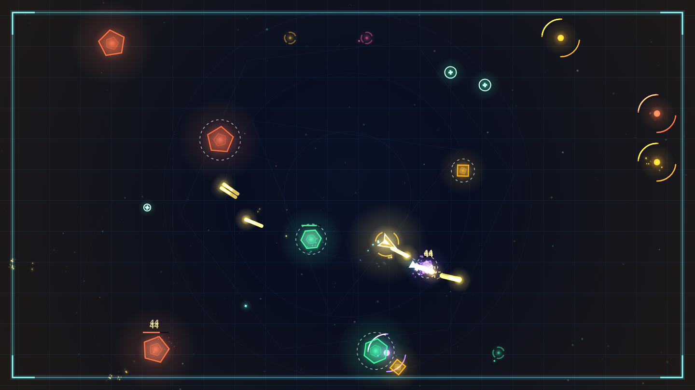
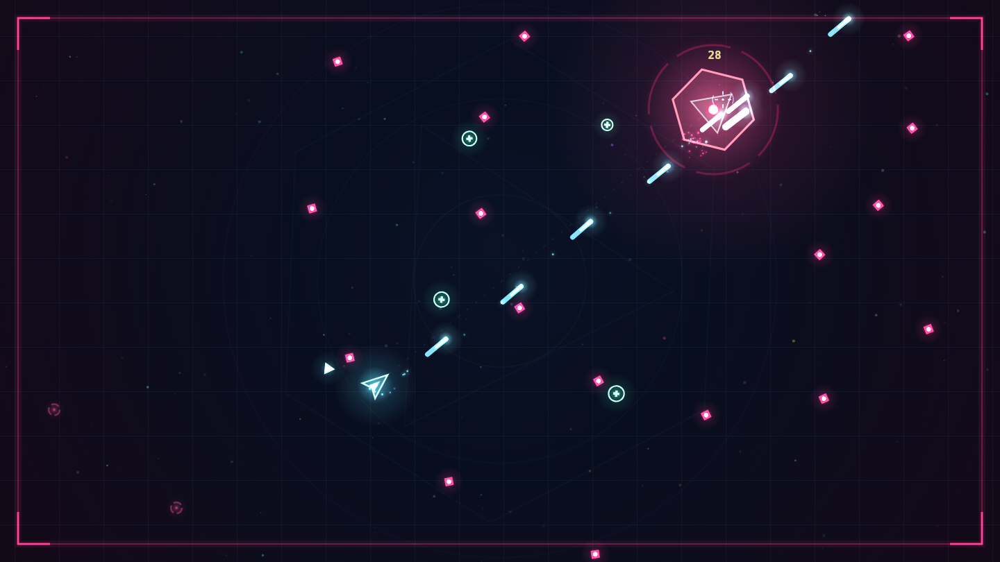

# NEON VOID

Неоновый аркадный twin-stick шутер с рогалик-прокачкой. Чистый Canvas 2D + WebAudio, **без единой картинки и без единого звукового файла** — вся графика рисуется векторами и свечениями, весь звук синтезируется в браузере.



```
Открой index.html через локальный сервер → играй.
```

```bash
python3 -m http.server 8080 --bind 0.0.0.0
# затем http://localhost:8080
```

## Что внутри

**Бой**
- Автоогонь по направлению мыши, прицел-перекрестие, рендер «неона» на аддитивных спрайтах-свечениях.
- Рывок с неуязвимостью, следом-призраками и уроном по всему, через что проходишь.
- Замедление времени на `SHIFT` — тратит энергию, враги и их пули ползут, ты стреляешь в полную силу.
- Овердрайв на `Q`: заряжается убийствами, 6 секунд сверхскорострельности, золотых пуль и неуязвимости.

**Волны**
- Бесконечные волны с растущим бюджетом врагов, подкрепления, интерлюдии.
- 6 типов врагов: дрейфы-треугольники, стрелки-квадраты, рывковые ромбы, делящиеся гексагоны, танки-пентагоны и мелкие осколки.
- **Элитные** враги с пунктирной аурой: втрое больше опыта и повышенный урон.
- Босс каждые 5 волн: три фазы, спиральные залпы, кольцевые взрывы, вызов подкреплений и разгон-таран с телеграфом.

**Прокачка**
- 18 улучшений трёх редкостей: пробитие, рикошет, криты, мультивыстрел, орбитальные клинки, взрывные пули, вампиризм, щит-фантом, крио-замедление и другие.
- Осколки опыта → уровень → выбор одной из трёх карт. Стаки видны на карточках.



**Сок**
- Тряска экрана, хитстоп, слоу-мо на смерти босса, всплывающие криты, шоквейвы, следы пуль, частицы, CRT-развёртка и виньетка.
- Процедурная музыка (синтвейв-луп Am–F–C–G) и синтезированные эффекты: выстрелы, попадания, взрывы, рывки, щиты, левелапы.
- Комбо-множитель до ×4.6, рекорд в `localStorage`.

## Управление

| Действие | Клавиша |
| --- | --- |
| Движение | `WASD` / стрелки |
| Прицел | мышь (огонь автоматический) |
| Замедление времени | `SHIFT` (удерживать) |
| Рывок | `ПРОБЕЛ` |
| Овердрайв | `Q` |
| Пауза | `ESC` / `P` |
| Звук | `M` |
| Рестарт | `R` (на паузе / экране поражения) |
| Выбор карты | `1` `2` `3` |

На телефоне: левый стик — движение, правый — прицел, кнопки справа — рывок и овердрайв. Без правого стика работает автонаведение.

## Структура

```
index.html        разметка: canvas + HUD + экраны
styles.css        неоновый интерфейс, карточки улучшений, CRT-оверлеи
src/main.js       canvas, игровой цикл, DOM-интерфейс, localStorage
src/game.js       симуляция: игрок, враги, босс, волны, апгрейды, коллизии
src/render.js     вся отрисовка (вектор + аддитивное свечение)
src/fx.js         частицы, кольца, всплывающий текст, кэш спрайтов свечения
src/audio.js      синтез SFX и процедурная музыка
src/input.js      клавиатура, мышь, виртуальные стики
src/data.js       палитра, типы врагов, улучшения, редкости
src/util.js       математика и работа с цветом
```

## Тесты и инструменты

```bash
npm test            # headless-симуляция 7 минут игры без зависимостей
npm install         # нужны для инструментов ниже
npm run test:ui     # jsdom: экраны, HUD, карточки, пауза, смерть, рестарт
npm run balance     # 10 ранов «среднего игрока» + замер производительности
npm run shots       # рендер игровых кадров в PNG (нужен @napi-rs/canvas)
```

`npm test` не требует зависимостей: он поднимает игру в Node с заглушкой canvas, гоняет бота, проверяет волны, боссов, апгрейды и отсутствие исключений.
