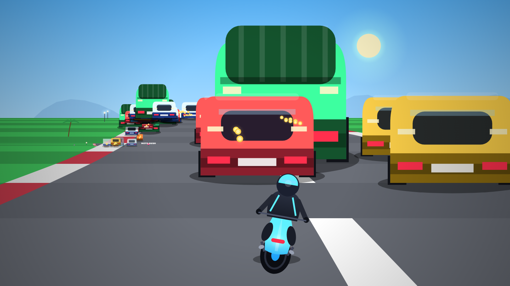

# MOTO RUSH

Аркадные мотогонки в браузере: **псевдо-3D трасса** и **вид сверху** (переключаются на ходу), трафик, монеты, нитро, вилли и **чит-коды, которые можно придумывать самому**.

Чистый Canvas 2D + WebAudio: **ни одной картинки и ни одного звукового файла** — вся графика рисуется векторами, звук синтезируется в браузере.



```bash
npm start          # python3 -m http.server 8080 --bind 0.0.0.0
# затем http://localhost:8080
```

Или просто открой `index.html` через любой локальный сервер (ES-модули не работают по `file://`).

## Управление

| Клавиши | Действие |
| --- | --- |
| `W` / `↑` | газ |
| `S` / `↓` | тормоз |
| `A` `D` / `←` `→` | руль |
| `SHIFT` / `ПРОБЕЛ` | нитро |
| `R` | вилли (нужна скорость и нитро) |
| `V` | переключить 2D ⇄ 3D |
| `C` или `` ` `` | чит-консоль |
| `ESC` / `P` | пауза |
| `M` | звук |

На телефоне: газ автоматический, руль и тормоз — кнопками внизу, нитро — отдельной кнопкой.

## Чит-коды

Встроенные (10):

| Код | Что делает |
| --- | --- |
| `TURBO` | 10 сек бесконечного нитро |
| `GODMODE` | 10 сек неуязвимости |
| `GHOST` | 8 сек проезда сквозь трафик |
| `RICH` | +5000 монет |
| `FAST` | скорость ×1.5 на 15 сек |
| `SLOWMO` | трафик едет ×0.4 медленнее 10 сек |
| `CLEARROAD` | убрать весь трафик с трассы |
| `WHEELIE` | вилли и +1500 очков |
| `REPAIR` | +50 прочности |
| `NIGHT` | сменить время суток (день → закат → ночь) |

**Свои коды.** В панели «Чит-коды» есть конструктор: придумываешь код (3–16 символов A–Z, 0–9), имя, выбираешь эффект, значение и длительность — и код сразу можно вводить в игре. Свои коды хранятся в `localStorage` (`moto.cheats.custom.v1`), их можно удалять кнопкой ✕. Дубликаты и слишком короткие коды не сохраняются.

Эффекты для конструктора: монеты, очки, бесконечное нитро, неуязвимость, призрак, буст скорости, замедление трафика, чистая дорога, ремонт, вилли, плотность трафика, смена темы.

## Что внутри

**Гонка**
- Псевдо-3D трасса из сегментов: повороты, подъёмы и спуски, пальмы, фонари, знаки и билборды; темы «день / закат / ночь».
- Альтернативный вид сверху с придорожными объектами и той же физикой.
- 6 типов трафика (седан, такси, фургон, грузовик, мопед, полиция) с разной скоростью и «ценой» обгона.
- Монеты, бонус за обгоны вплотную, вилли, нитро с расходом и зарядкой.
- Прочность: 4 аварии — и заезд окончен; рекорд, дистанция и монеты хранятся в браузере.

**Гараж**
- 4 байка с разными характеристиками: `STORM 250`, `VIPER 600`, `NIGHTHAWK 1000`, `CRUISER X`.

**Интерфейс**
- Живой HUD (скорость, счёт, прочность, нитро, активные читы), баннеры, тосты, вспышки.
- Чит-консоль (`C`) с историей ввода, панель управления кодами, экраны старта / паузы / результатов.
- Тач-управление и адаптивная вёрстка.

**Звук** синтезируется целиком: двигатель зависит от скорости, нитро, монеты, обгоны, аварии, фанфары читов.

## Тесты

```bash
npm test        # headless-симуляция заезда и читов (tests/smoke.mjs)
npm run test:ui # jsdom: интерфейс, чит-консоль, конструктор кодов (tests/ui.mjs)
npm run balance # сравнение байков и режимов (tests/balance.mjs)
npm run shots   # скриншоты кадров в screenshots/ (tests/render-shots.mjs)
node tests/perf.mjs # производительность на плотной сцене
```

## Структура

```
index.html        разметка сайта: игра, гараж, читы, «как играть», рекорды
styles.css        оформление (тёмная неоновая тема, адаптив, тач)
src/main.js       точка входа: цикл, экраны, HUD, чит-консоль, localStorage
src/game.js       движок: трасса, физика, трафик, монеты, читы, HUD-данные
src/render.js     отрисовка псевдо-3D и вида сверху
src/cheats.js     менеджер кодов: валидация, хранение, применение эффектов
src/data.js       байки, типы трафика, каталог эффектов, встроенные коды
src/audio.js      процедурный WebAudio
src/input.js      клавиатура, мышь, виртуальные стики
src/fx.js         частицы, кольца, всплывающий текст
src/util.js       математика и цвет
```
